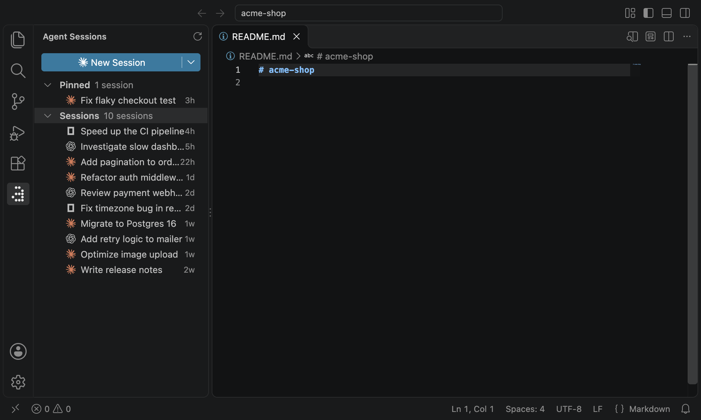

# Agent Sessions

**Every Claude Code, Codex, OpenCode and Kimi conversation of your project, one click away.**

You start a session, switch branches, close the window, and a few days later you can't remember which conversation had the answer. Agent Sessions puts all of them in a panel in your Activity Bar, newest first, so you can jump back in without digging through `claude --resume` or `codex resume`.



## Why you'll like it

- **All your agents in one list.** Claude Code, Codex, OpenCode and Kimi sessions side by side, each with its own icon and the time of the last activity. Claude Code running on GLM or DeepSeek gets its own icon too.
- **Back in the conversation in one click.** Click a session and it resumes in an editor tab, named after the session. No terminal commands to remember.
- **New session, your agent.** Press **New Session** to start the selected agent right in your project. Switch agents from the dropdown next to the button.
- **Your sessions, your way.** Pin the ones you keep coming back to, rename the ones with unhelpful titles and delete the ones you no longer need. Right-click a session. Claude sessions can also be reopened with or without Claude in Chrome (`--chrome`) from the same menu; the choice is remembered for that session.
- **Nothing gets lost.** Close VS Code with a few sessions open and they come back when you reopen the project.
- **Limits at a glance.** The status bar shows how much of your usage limit is used. Hover it to see the windows and when they reset; the tooltip follows the agent of the session you are in.
- **Titles you already know.** Names come from the agents: Claude Code's AI titles and `/rename`, Codex thread names, OpenCode and Kimi session titles.

## Getting started

1. Install the extension and open a project folder.
2. Click the **Agent Sessions** icon in the Activity Bar. Your existing sessions are already there.
3. Click a session to continue it, or press **New Session**.

Works with multi-root workspaces too: sessions from every folder are listed, and new ones start in the folder you're working in.

## Requirements

- VS Code 1.101 or newer
- macOS or Linux
- At least one of [Claude Code](https://docs.claude.com/en/docs/claude-code), [Codex CLI](https://github.com/openai/codex), [OpenCode](https://opencode.ai) or [Kimi Code](https://github.com/MoonshotAI/kimi-code), installed and signed in

## Settings

Most people never need to change anything. If you do:

| Setting | What it does |
| --- | --- |
| `agentSessions.agents` | Change an agent's command, turn it off, or add your own. |
| `agentSessions.limits.enabled` | Show usage limits in the status bar (on by default). When off, nothing is added to the status bar and no limit data is collected. |
| `agentSessions.limits.refreshMinutes` | How often usage limits are refreshed, 1–60 minutes (default 1). |
| `agentSessions.limits.statusBarWindow` | Which limit the status bar shows and colors by: `first` (Claude's 5-hour window, default) or `highest` (the most used one). |
| `agentSessions.limits.warningPercent` | Used percentage from which the status bar item turns to the warning background (default 80). |
| `agentSessions.limits.errorPercent` | Used percentage from which it turns to the error background (default 95). |
| `agentSessions.limits.claude.enabled` | Show Claude Code usage limits in the status bar tooltip (off by default, see Usage limits). |
| `agentSessions.claudeProjectsPath` | Use a different Claude Code projects folder (default `~/.claude/projects`). |

For example, to start Codex with web search and hide Claude from the New Session menu:

```jsonc
"agentSessions.agents": [
  { "id": "codex", "command": "codex --search" },
  { "id": "claude", "enabled": false }
]
```

Agents you add yourself show up in the New Session menu. Their past sessions are not listed.

## GLM and DeepSeek

**GLM (Claude Code)** and **DeepSeek (Claude Code)** in the New Session menu start Claude Code on the [Z.ai GLM Coding Plan](https://docs.z.ai/devpack/overview) or on [DeepSeek](https://api-docs.deepseek.com/guides/anthropic_api) through their Anthropic-compatible endpoints. You need Claude Code installed and an API key of the service.

- The first time, you are asked for the API key. It is kept in VS Code secret storage (the system keychain) and passed to Claude Code only through the environment of the session's terminal. Change or remove it with **Agent Sessions: Set Z.ai API Key (GLM)** or **Agent Sessions: Set DeepSeek API Key** (leave the field empty to remove it).
- These sessions are Claude Code sessions, so they are listed together with your Claude sessions, with the GLM or DeepSeek icon. Sessions started from here are always recognized; sessions you started yourself are recognized by the model name in the session file. They resume on the same service.

## Usage limits

Hover the status bar item to see your limits (click it to refresh):

- **Codex:** read from your local Codex session files. It shows the last value Codex reported, so it updates when you use Codex.
- **Claude Code:** the first time, you are asked whether to enable it (nothing is read before you agree). You can switch it with `agentSessions.limits.claude.enabled`. When enabled, the extension reads your Claude Code login (macOS Keychain or `~/.claude/.credentials.json`) and asks `api.anthropic.com` for your 5-hour and weekly usage (and your extra usage spend, if extra usage is turned on), every minute by default (`agentSessions.limits.refreshMinutes`) while a window is focused; all open windows share one request. The token is used only for that request, never stored or logged. This endpoint is the one Claude Code's own `/usage` command uses, but it is not officially documented and may change. Available for Pro and Max subscriptions.
- **OpenCode:** has no subscription limits of its own, so the tokens spent in the active session (and their cost) are shown instead.
- **GLM:** once a Z.ai API key is set, the 5-hour and weekly quota of your GLM Coding Plan (and the monthly MCP quota) is read from `api.z.ai`. This endpoint is the one Z.ai's own usage plugin uses, but it is not officially documented and may change.
- **DeepSeek:** once a DeepSeek API key is set, your account balance is read from `api.deepseek.com`. The status bar turns red when the balance is not enough for API calls.
- **Kimi:** no usage limits are shown yet.

## Good to know

- **Private by design.** Agent Sessions only reads the session files already on your machine and sends nothing anywhere. The opt-in exceptions are the usage limits of Claude, GLM and DeepSeek (see above): each is requested only from that service.
- **Renames are local.** A name you set here is saved in VS Code and isn't written back to the agent.
- **New Codex, OpenCode and Kimi sessions.** A brand-new session shows up in the list after your first message.
- **Deleting is permanent.** **Delete** removes the session from the agent's own history on this computer: the session file of Claude Code or Codex, the session folder of Kimi, and for OpenCode it runs `opencode session delete`. It can't be undone.
- **Untrusted folders.** In Restricted Mode the extension won't start or resume agents.

## License

[MIT](LICENSE)

## Feedback

Something broken, or an agent you'd like to see? [Open an issue](https://github.com/hopleus/vscode-agent-sessions/issues).

---

*Agent Sessions is an independent project and is not affiliated with Anthropic, OpenAI or JetBrains. Claude and Claude Code are trademarks of Anthropic; Codex and OpenAI are trademarks of OpenAI; OpenCode is a trademark of its respective owner.*
